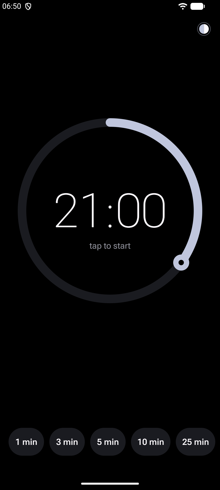
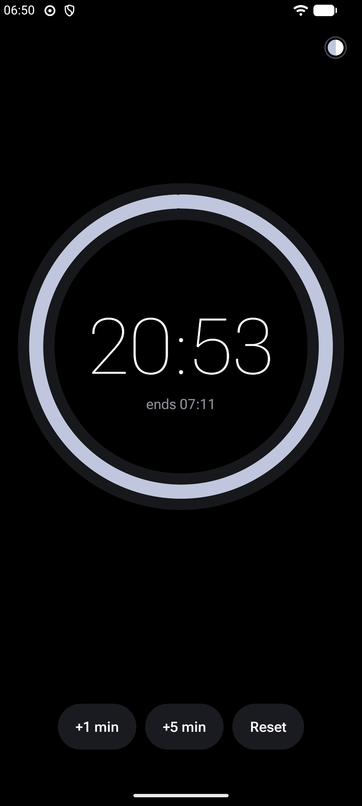
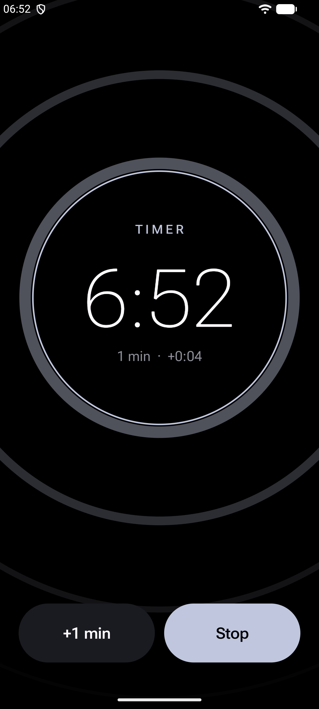
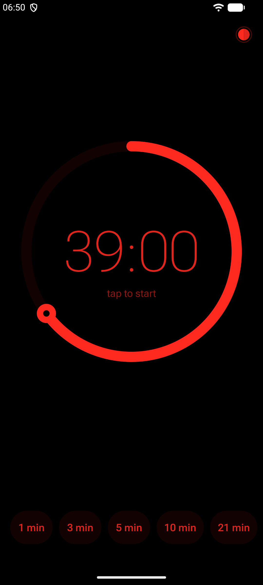

# Timer

**One dial. Spin to set, tap to start. Rings over the lock screen.**

A timer that is just a dial. Spin it to set a time, tap the middle to start.

    

## Features

- One turn of the dial is 60 minutes, snapping to whole minutes. Keep turning for hours.
- Your five most recent times sit underneath as one-tap chips.
- While it runs: the end time, +1 min, +5 min and Reset. Tap the middle to pause and resume.
- A live countdown in the notification shade (a status-bar chip on Android 16).
- When time's up it rings full-screen, even on the lock screen, with a quick volume ramp and vibration. Add a minute from the ring screen, or silence it with a volume key. It gives up after 10 minutes.
- Answers "set a timer" requests from assistants and other apps.
- Exact timing even in Doze; survives reboots.
- Seven themes, switched by tapping the dot at the top right: You (Material You colours from your wallpaper), Night (pure AMOLED black and red, for the dark), Auto (Night from 21:00 to 07:00, You otherwise), Mono, Ember, Glacier and Paper (light).

Tiny (under 100 KB), with no ads, tracking or analytics, and no dependency on Google Play Services. Needs Android 13 or newer.

## Install

- **GitHub:** download the APK from the [latest release](https://github.com/robbie-med/timer/releases/latest).
- **Obtainium:** add `https://github.com/robbie-med/timer` to get updates automatically.
- **F-Droid:** not listed yet. The repo is ready for it: plain Gradle with no proprietary libraries, a version tag per release, and store metadata in `fastlane/`.

Release APKs are signed with this certificate (SHA-256):

```
27:77:55:ce:89:82:9c:ad:ea:1c:f7:c7:6a:1e:44:be:7f:ef:3a:38:8c:49:94:8a:95:b1:0a:d4:f4:93:54:42
```

Check it with `apksigner verify --print-certs Timer-1.0.apk`.

## Permissions

| Permission | Why |
|---|---|
| `USE_EXACT_ALARM` | To end exactly on time, even in Doze. |
| `POST_NOTIFICATIONS, POST_PROMOTED_NOTIFICATIONS` | The live countdown and the ring notification. |
| `USE_FULL_SCREEN_INTENT` | To ring over the lock screen. |
| `FOREGROUND_SERVICE (system-exempted / media playback)` | To keep ringing reliably. |
| `RECEIVE_BOOT_COMPLETED` | To restore a running timer after a reboot. |
| `VIBRATE, WAKE_LOCK` | Vibration and keeping the CPU awake while ringing. |

## Build

Needs JDK 17 and the Android SDK (platform 36).

```sh
./gradlew assembleRelease
```

The APK lands in `app/build/outputs/apk/release/`. It is unsigned unless a `keystore.properties` file exists in the repo root with `storeFile`, `storePassword`, `keyAlias` and `keyPassword` (it is gitignored).

The code is plain Kotlin on the Android framework: no AndroidX, no Compose, no third-party libraries. `core/` holds the shared drawing, theme and typography code, `ring/` the alarm engine (scheduling, the ring service and screen), and `app/` the app itself.

## Siblings

[World](https://github.com/robbie-med/world_clock) · [Alarm](https://github.com/robbie-med/alarm): the same look, each doing one job.

## License

[GPL-3.0-or-later](LICENSE). Package: `org.robbiemed.tick`.
